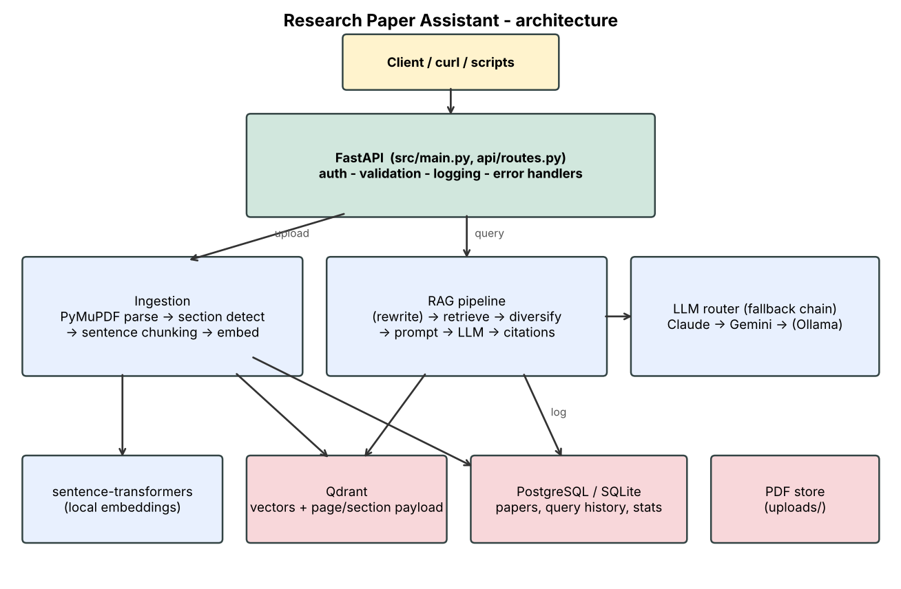

# Research Paper Assistant (RAG)

Upload academic PDFs, then ask questions and get answers with **citations (paper, section, page)**.
Built with FastAPI, Qdrant, sentence-transformers, SQLAlchemy (SQLite/Postgres) and a
**Claude + Gemini LLM chain with automatic fallback** (Ollama optional).



## Quick start (Docker)

```bash
cp .env.example .env          # add ANTHROPIC_API_KEY and/or GEMINI_API_KEY
docker compose up --build     # Qdrant + Postgres + API on http://localhost:8000
```
Interactive docs: http://localhost:8000/docs

## Quick start (local)

```bash
python -m venv venv && source venv/bin/activate      # Windows: venv\Scripts\activate
pip install -r requirements.txt
cp .env.example .env                                  # add API key(s)
docker run -d -p 6333:6333 qdrant/qdrant              # vector DB
uvicorn src.main:app --reload
```
No Docker? Set `QDRANT_URL=:memory:` for a throw-away in-process vector store (data is lost on restart).
SQLite is the default database; set `DATABASE_URL=postgresql+psycopg2://...` for Postgres/MySQL.

## Using Claude and Gemini together

Set the order in `.env`; the first provider that succeeds answers, the rest are fallbacks:

```env
ANSWER_PROVIDERS=claude,gemini     # Claude first, Gemini if Claude errors / rate-limits
REWRITE_PROVIDERS=gemini,claude    # optional cheap model for query rewriting
REWRITE_ENABLED=true
```
Add `ollama` to either list for a local fallback. Each response reports `llm_provider`.
Model names are configurable (`CLAUDE_MODEL`, `GEMINI_MODEL`). Gemini model IDs retire often (the 2.5 family already did), so copy a current Flash ID from AI Studio.
Embeddings always run locally (sentence-transformers), so neither API sees your full corpus, only retrieved excerpts.

## Try it with your papers

```bash
python scripts/ingest_samples.py sample_papers        # uploads every PDF in the folder
python scripts/run_test_queries.py                    # runs test_queries.json, prints source recall
```
`run_test_queries.py` matches expected papers by number (`paper_3.pdf` ~ `paper3_nlp_transformers.pdf`).
Read `results/test_run.json` yourself: citation recall does not prove an answer is correct.

## Topic research: find, extract, track, summarise

Pick a topic and the app searches **arXiv + OpenAlex** (free), downloads the **open-access** PDFs, indexes
them, pulls out the exact section(s) that match, keeps your excerpts and references, and writes a cited summary.

```bash
python scripts/research.py "self-attention for long sequences" --papers 5 --out review.md
```
Or step by step (every step is an endpoint; see `/docs`):

| Step | Call |
|---|---|
| Create a topic | `POST /api/topics` `{"name": "...", "query": "..."}` |
| Search (replaces the candidate list) | `POST /api/topics/{id}/search` `{"limit": 15}` - or stateless `POST /api/discover` |
| Import chosen papers | `POST /api/topics/{id}/import` `{"indexes": [0,2]}` or `{"top_n": 5}` |
| Exact matching sections | `POST /api/topics/{id}/sections` `{"query": "...", "per_paper": 2, "full_section": true}` - saved as excerpts |
| Annotate / remove excerpts | `PATCH /api/excerpts/{id}` `{"note": "..."}` / `DELETE` |
| Find more via citations | `POST /api/topics/{id}/expand` `{"direction": "references" \| "citations"}` |
| Bibliography | `GET /api/topics/{id}/references?format=json\|bibtex\|markdown` |
| Cited summary | `POST /api/topics/{id}/summary` `{"focus": "...", "max_papers": 5, "style": "overview\|compare\|brief"}` |
| Everything in one file | `GET /api/topics/{id}/export` (summary + excerpts + references + BibTeX) |

Notes:
- **Free-tier friendly:** a summary costs one LLM call (two+ only if the excerpts are very long). Discovery and
  extraction use no LLM at all.
- **Setup:** get a free OpenAlex key at https://openalex.org/settings/api (`OPENALEX_API_KEY`). arXiv needs no key but allows
  one request per 3 s, so importing N arXiv papers takes roughly 3N seconds.
- **Open access only:** papers without a legal open-access PDF are reported as `no_pdf` (you can still upload them manually
  and `POST /api/topics/{id}/papers/{paper_id}` to attach them). Set `UNPAYWALL_EMAIL` for an extra OA fallback.
- **"Exact section"** means the real section text from the PDF (`full_section=true`); long sections fall back to the matching
  passages and are flagged `truncated`. Gaps between non-adjacent passages are marked with `[…]`.
- Existing v1 databases upgrade automatically (new columns are added on startup).

## API

| Method | Path | Purpose |
|---|---|---|
| POST | `/api/papers/upload` | multipart PDF (`file`); optional `title`, `authors`, `year` overrides |
| GET | `/api/papers` | list (`skip`, `limit`) |
| GET | `/api/papers/{id}` | details (counts a view) |
| GET | `/api/papers/{id}/download` | original PDF (counts a download) |
| GET | `/api/papers/{id}/stats` | views, downloads, times cited |
| DELETE | `/api/papers/{id}` | removes vectors, DB row, file |
| POST | `/api/query` | ask a question |
| GET | `/api/queries/history` | recent queries (`limit`, `offset`) |
| POST | `/api/queries/{id}/rating` | `{"rating": 1-5}` |
| GET | `/api/analytics/popular` | popular topics, most-cited papers, avg latency/rating |
| GET | `/health` | DB, Qdrant, configured LLMs |

If `API_KEY` is set, send `X-API-Key: <key>` on all `/api/*` calls.

```bash
curl -F "file=@sample_papers/paper3_nlp_transformers.pdf" http://localhost:8000/api/papers/upload

curl -X POST http://localhost:8000/api/query -H "Content-Type: application/json" -d '{
  "question": "What methodology was used in the transformer paper?", "top_k": 5, "paper_ids": [3]}'
```
```json
{
  "query_id": 1,
  "answer": "The paper uses a self-attention based encoder-decoder ... [1][3]",
  "citations": [{"paper_id": 3, "paper_title": "Attention Is All You Need", "section": "Methodology",
                 "page": 3, "page_end": 3, "relevance_score": 0.71, "excerpt": "..."}],
  "sources_used": ["paper3_nlp_transformers.pdf"],
  "confidence": 0.82, "response_time_ms": 1840.2, "llm_provider": "claude", "cached": false
}
```
Errors: `409` duplicate upload / empty library, `413` too large, `415` not a PDF, `422` unreadable or scanned PDF /
validation, `404` unknown paper, `503` Qdrant or all LLMs unavailable.

## Tests

```bash
pytest -q     # PDF parsing/chunking, LLM fallback, and a full API flow (in-memory Qdrant, fake embedder + LLM)
```
Tests need no network, model download or API keys.

## Project layout
```
src/main.py            app, logging, error handlers, /health
src/api/routes.py      endpoints          src/api/deps.py   auth + singletons
src/services/          pdf_processor, embedding_service, qdrant_client, rag_pipeline, llm, cache, analytics
src/models/            SQLAlchemy models + pydantic schemas
src/services/          ... + discovery (arXiv/OpenAlex), research (sections, summaries), biblio (BibTeX)
src/api/research.py    topic endpoints
scripts/               ingest_samples, run_test_queries, research (one-command review), make_architecture
```
See [APPROACH.md](APPROACH.md) for design decisions and limitations.
